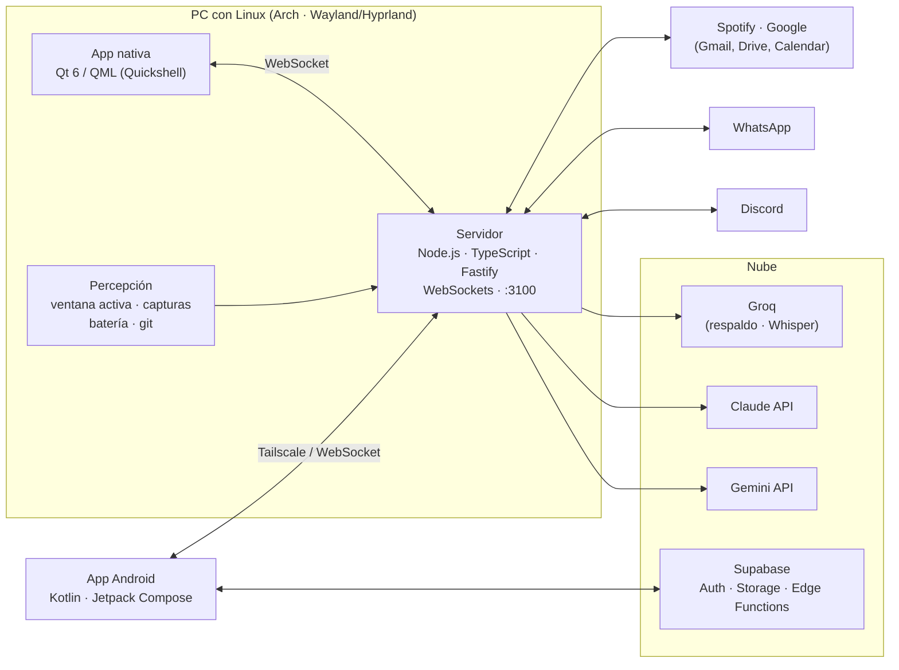

# White Space OS

**Un sistema de seis asistentes de IA con personalidad propia, que viven en un escritorio Linux y en un teléfono Android.**
*Six AI companions with their own personalities, living on a Linux desktop and an Android phone.*

> Esta es una **muestra del proyecto**: arquitectura, decisiones de ingeniería y capturas. El código fuente es privado y está disponible para revisión a solicitud.

---

## Qué es

White Space es un compañero de escritorio y de bolsillo hecho de seis agentes. Cada uno tiene un rol, una forma de hablar y un estado emocional que cambia cómo responde:

| Agente | Rol en el sistema |
| --- | --- |
| Orquestador | Reparte el trabajo, decide quién responde y resume |
| Auditora | Revisa el código y los cambios en rondas; exige cero errores |
| Despachador | Clasifica rápido lo que llega y responde lo ligero |
| Arquitecto | Diseña y construye; tipos estrictos y orden |
| Memoria | Guarda recuerdos, documentación y el álbum del proyecto |
| Bienestar | Puntos de control (commits y respaldos), descanso y rutinas |

Los agentes conversan entre ellos, se piden ayuda cuando no saben algo y aprenden habilidades unos de otros, adaptándolas a su rol.

## Arquitectura

**En cifras:** ~117.000 líneas · ~250 commits · 72 módulos de servidor · 28 pantallas en Android · 10 integraciones externas.

| Parte | Tecnología | Líneas aprox. |
| --- | --- | --- |
| Servidor y cerebro | Node.js, TypeScript, Fastify, WebSockets | 41.000 |
| App de escritorio | Qt 6 / QML (Quickshell), capas Wayland | 34.000 |
| App Android | Kotlin, Jetpack Compose, biometría | 32.000 |
| Escritorio (barras, widgets, arranque) | QML, shell, Plymouth | 8.600 |
| Funciones en la nube | Supabase Edge Functions (Deno) | 1.300 |

## Decisiones de ingeniería

**1. Una escalera de modelos, no un solo modelo.**
Cada mensaje se clasifica antes de responder. La charla ligera va a modelos pequeños y rápidos con razonamiento mínimo. El trabajo pesado (diseñar, auditar código) va a un modelo grande con razonamiento alto. Si un proveedor agota su cuota, el sistema baja al siguiente sin que el usuario lo note, y el uso diario de cada modelo se ve en la app.

**2. El cerebro decide las acciones, no las expresiones regulares.**
Un módulo de decisión le pide al modelo un plan estructurado (JSON con esquema): responder, usar una herramienta o pedir ayuda a otro agente. Las herramientas («manos») son módulos con permisos; las nuevas las construye el agente arquitecto y la auditora las revisa en rondas antes de activarlas.

**3. Nada irreversible sin aprobación.**
Enviar un correo, mover archivos en Drive, hacer un commit o compartir algo genera una tarjeta de aprobación. Se aprueba en el escritorio o en el teléfono, y en el teléfono la firma va con huella digital.

**4. Respetar los límites de las APIs.**
Una lección real: un exceso de peticiones a la API de Spotify bloqueó la cuenta durante horas. Desde entonces hay una caché compartida (una petición real cada 3 s como máximo) y se respeta siempre la cabecera `Retry-After`. Otra: nunca usar una suscripción de consumo como motor 24/7; solo APIs oficiales con su propia clave.

**5. No perder datos del usuario.**
Las grabaciones de reuniones del teléfono se guardan primero en el dispositivo y solo se borran cuando la subida se confirma. Los audios largos van a la API de archivos de Gemini en lugar de enviarse codificados en la petición, y el archivo remoto se borra solo después de que la respuesta se valida. La sesión del teléfono sobrevive a fallas de red: solo se cierra ante un rechazo real del servidor.

**6. Respuestas en vivo.**
Mientras un agente piensa, usa herramientas y habla, todo aparece en un solo mensaje que crece, en el escritorio y en el teléfono, con el trabajo de cada agente visible en tiempo real.

**7. Interfaz nativa, no web.**
La primera versión era una app web; se retiró para pasar a una app nativa en Qt 6/QML sobre capas de Wayland: una isla superior siempre presente y una ventana principal con chat, equipo, álbum y opciones. Menos memoria y mejor integración con el escritorio.

## Capturas

*(Próximamente: capturas de la app Android y del escritorio.)*

## Qué aprendí

- Diseñar sistemas multiagente con roles claros y comunicación entre agentes.
- Elegir modelos por costo, latencia y cuota, y degradar con elegancia cuando uno falla.
- Llevar una misma experiencia a tres superficies (servidor, escritorio y móvil) sin duplicar la lógica.
- Tratar con APIs externas reales: OAuth, límites de tasa, sesiones y reintentos.

Desarrollado con flujos de trabajo asistidos por IA (Claude Code) para arquitectura, revisión de código y pruebas. El diseño, las decisiones y la dirección del proyecto son míos.

## Inspiración y créditos

White Space es un **proyecto de fans sin fines de lucro**, hecho con cariño por el videojuego **OMORI**. La personalidad de los agentes y la estética de la interfaz están inspiradas en él.

**OMORI, sus personajes y su arte © OMOCAT, LLC.** Este proyecto no está afiliado ni respaldado por OMOCAT. Este repositorio no incluye arte, sprites ni recursos del juego.

---

**José Alejandro Reyes** · [LinkedIn](https://www.linkedin.com/in/jose-reyes-berrocal) · [GitHub](https://github.com/ReyesMirrors)
